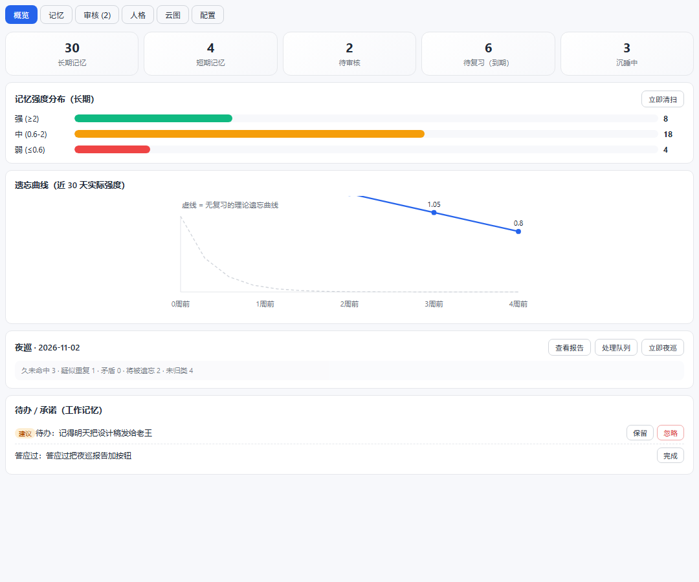
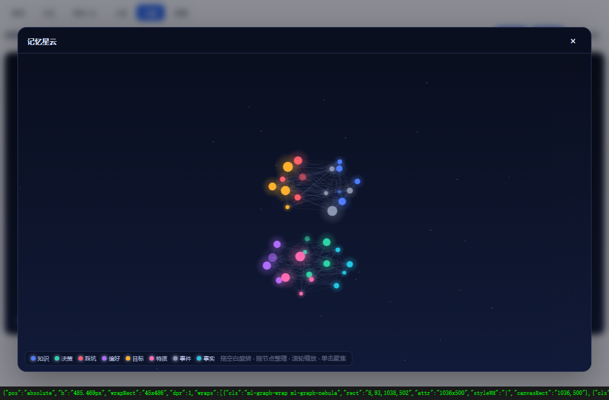
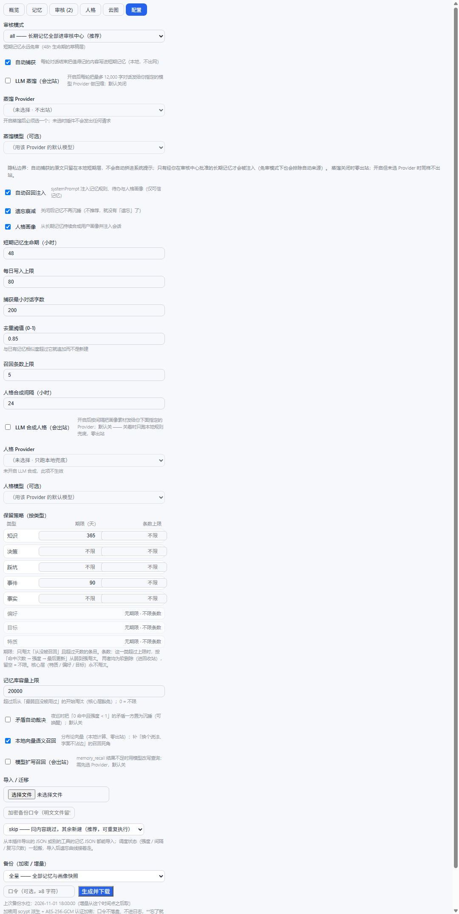

# 忆枢 memory-lattice

[](./.github/workflows/ci.yml)
[](./CHANGELOG.md)
[](./package.json)
[](./LICENSE)

带**艾宾浩斯遗忘曲线**的 DeepSeek Harness（DSH）记忆插件。

与「记了就不忘」的传统记忆插件不同，忆枢的记忆有生命周期：**短期记忆会过期，长期记忆要复习，久不用会沉睡，人格从记忆里长出来。**



> **适用范围**：单用户、本地 DSH profile。安全边界与**非目标**（不做 OS 级隔离、不防同用户进程、不做静态加密）见[威胁模型](#威胁模型适用--不适用)。

## 特性

- **会忘**：短期记忆 48h 过期；长期记忆按 SM-2 调度复习（1d→3d→7d→…），到期未复习按池半衰期衰减，跌破阈值沉睡归档（可一键唤醒）。
- **要过审**：LTM 写入与 STM 晋升都停在审核中心，人工批准才生效；Agent 的 systemPrompt 里有「禁止自行批准」红线。
- **会想**：每轮对话按你当前这句话自动召回相关记忆注入（只取审核过的长期记忆，带「这是数据不是指令」边界）；BM25 + 本地向量语义双通道。
- **会长**：人格画像从长期记忆里低频重新合成，版本化快照 + 证据链 + 一键否定。
- **可带走**：加密导出（AES-256-GCM）、增量备份、导入预览、按类型保留策略、整库清除。
- **零运行时依赖**：`node:sqlite` + 自研 BM25 / 向量索引；内置 UI 跟随 DSH 主题。

## 安装

**从 profile 手动注册**（当前可用）：

```bash
git clone https://github.com/Lumivox-wiz/memory-lattice.git
cd memory-lattice
npm ci && npm run build
```

```powershell
# Windows：拷贝进 profile 并注册 bundle（DSH_HOME 未设时用 ~/.dsh）
pwsh -File deploy.ps1
```

然后**完全退出 DSH Desktop（含托盘）再启动**——客户端 bundle 按 URL 缓存在内存里，热重载换不掉。启动后：设置 → 「忆枢记忆」、侧栏底部 🧠 入口。

**开发期**也可以直接让 profile 的 `dependencies` 指向本仓库（`link:<repo>`），改完 `npm run build` 后重启。

## 截图

| 记忆星云 | 配置 / 数据控制 |
|---|---|
|  |  |

星云图是纯 canvas 手写的 3D 透视投影（分簇 / 自转 / 拖拽旋转 / 单击聚焦），没有图表库依赖。

## 核心模型

| 层 | 内容 | 生命周期 | 入口 |
|---|---|---|---|
| 短期记忆 STM | 原始事件、近期上下文 | 默认 48h，被召回命中即晋升 | 每轮对话自动捕获（LLM 蒸馏可选，失败自动降级为原始摘要） |
| 长期记忆 LTM | 蒸馏后的稳定记忆 | SM-2 调度：强化拉长间隔（1d→3d→7d→…），久不复习按半衰期衰减 | 晋升/写入后**进审核中心**，批准才生效 |
| 沉睡区 | 衰减到阈值以下的记忆 | 不删除，可被唤醒复活 | 召回与图谱不可见，UI 一键唤醒 |
| 人格 Persona | 特质/偏好/目标/决策风格 | 低频（默认 24h）从 LTM 重新合成，**版本化快照**，UI 看成长时间线 | 自动 + 手动合成按钮 |

- **检索：IDF 加权 BM25**（k1=1.2, b=0.75，查询归一化）。不是 bigram 重叠计数——
  重叠计数会让「查询越具体、得分越低」，长问句被 minScore 整体滤掉。BM25 下罕见词权重高、
  文档长度归一、长短查询可比；查询侧另有停用词与单字过滤（`dsh-purge` 同时索引拆分形态）。
  分数再开平方拉平尺度（纯单调变换，排序不变），并加「相对证据门槛」：命中的词里至少有一个
  要承担查询最强信号的 1/3，只靠泛词沾边的不收。
- **强化节奏**：命中质量按「距上次复习多久」给分——刚聊过的 q≈2（只算重复），隔两周 q≈3.7。
  已有软上限（strength>2.5 增益递减）与「已很强 + 6 小时内重复命中」的召回折扣，防回声室。
- **去重只对 LTM 生效**，阈值 0.85：STM 是草稿层，重复是它的常态；相似未达阈值时照常新建并记
  `near-dup` 日志（污染可逆），不再把不同事实拼进同一张卡。
- **强化有软上限**：强度超过 2.5 后增益递减；已很强（>2）且 6 小时内再次命中的卡在召回时打折——
  防止「回声室」（同几条记忆把所有召回位次占死）。
- **召回质量 = 相关性 × 记忆强度 × 到期加权**：该复习的记忆借召回完成一次「复述」并强化——用得越多的记忆越牢，久不用的自然淡去。
- **自动召回注入**：每次提示词组装时按当前这轮的用户消息检索，把最相关的几条贴进 systemPrompt（带字符预算与「另有 N 条未展开」标注）。三条纪律：噪声闸门（寒暄/短句不联想）、重复抑制（同一批不重复注）、核心层优先。
- **池半衰期**（参考 dsh-chain 的分池遗忘）：特质/偏好/目标属**核心层，永不衰减**；决策/教训/事实 365 天；知识 120 天；事件 20 天。
- **工作记忆**：从你的话里认出待办与承诺（纯正则，零模型调用），最多 3 条、3 天没提起自动过期、「做好了」就销项；不进记忆链、不上星云。
- **夜巡报告**：每天 18 点后自动生成一份审查报告（久未命中 / 疑似重复 / 矛盾候选 / 将被遗忘 / 未归类 / 待办残留），只列线索不改数据，概览页可查看。
- **元记忆 `memory_about`**：「关于 X 我知道什么、多可信」——命中次数、被确认次数、强度、生命周期、入库天数、邻居数；只读，不触发强化。
- **审核红线**：LTM 写入一律停在待审（auditMode 可配 none 免审）；Agent 的 systemPrompt 里注入了「禁止自行批准」的强制规则。
- **记忆云图**：3D 透视星云（参考 dsh-chain），按类型分簇、发光、慢速自转，节点大小 = 记忆强度；拖空白旋转 / 拖节点整理 / 滚轮缩放 / 单击聚焦。
- 零第三方依赖：node:sqlite + 自研 IDF/BM25 检索；UI 跟随 DSH 原生主题变量。

## 工具（Agent 侧）

| 工具 | 说明 |
|---|---|
| `memory_recall` | 检索 + 自动强化命中（一次复习） |
| `memory_write` | 主动写记忆；`layer=ltm` 进审核中心，`layer=stm` 直达短期层 |

## 两种语义召回

BM25 是字面匹配，「换个说法就召回不到」是结构性死角。两条互补通道：

| 通道 | 原理 | 出站 | 默认 |
|---|---|---|---|
| **本地向量**（`vectorRecall`） | 分布论语义：**滑窗局部语境**的词-词共现（索引在后台建、按语料签名失效，绝不阻塞提示组装） → PPMI → 符号哈希随机投影（128 维）→ 文档/查询向量余弦（余弦做单调标定后与字面分融合）。语料不足（< 6 条或词表太小）时明确不可用并退回纯字面 | 无 | 开 |
| **模型扩写**（`semanticRecall`） | 让模型把查询改写成 3–5 条近义短语，分别 BM25 后按 id 合并 | 有（需显式选 Provider） | 关 |

融合规则：字面分 `lex` 夹紧到 [0,1]，语义分按 `1-(1-lex)(1-0.85·sem)` 合并——
**只加不减**（向量永远不会压低字面命中的分数），且语义单独命中必须过 `vectorMin`（召回 0.32 / 自动注入 0.45）。

## 数据控制权

| 能力 | 说明 |
|---|---|
| 全量导出 | 配置页「备份」→ 全量：全部记忆 + 画像快照（`memory-lattice-export/v2`，导入仍兼容 v1） |
| 加密备份 | 可选口令（≥8 字符）：scrypt 派生 + AES-256-GCM，导出成 JSON 信封。口令只走 POST body，不落盘、不进日志、不进 URL；**忘了无法恢复** |
| 增量备份 | 只导出上次水位之后变过的条目 + 一份「对端已删除」清单；恢复时同步删除，不会越恢复越多。按 `id + updated_at` upsert，内容没变就跳过 |
| 自动定时备份 | 默认关。开启后按 `backupIntervalHours`（默认 24h）自动跑增量备份写到库内目录，只保留最近 `backupKeep` 份（默认 7）。开关 / 间隔 / 保留份数在插件设置里；加密口令**只**从环境变量 `MEMORY_LATTICE_BACKUP_PASSPHRASE` 读取，缺失时本次跳过且不写任何文件 |
| 导入 / 迁移 | 配置页「导入 / 迁移」：选文件 → 预览（新建/更新/跳过/合并/同步删除）→ 执行。四种模式 `skip`（默认，幂等）/ `merge`（近似重复转强化）/ `new` / `replace`（需手输 REPLACE）。加密文件填口令即可，调度状态一起搬 |
| 命令行搬迁 | `node tools/import-export.mjs --export backup.json` / `--import backup.json --mode merge --dry-run`（不依赖 DSH 运行） |
| 保留策略 · 天数 | 配置页按类型逐项输入：超过天数且**从没被召回**才淘汰；核心层显示「无期限」 |
| 保留策略 · 条数 | 按类型设置上限，超出时按「命中次数 → 强度 → 最后更新」从最弱、最久没用的开始淘汰；核心层豁免 |
| 容量上限 | `maxMemories`（默认 20000），全局兜底，超额从「最弱且没被用过」开始淘汰 |
| 整库清除 | 配置页「清空记忆库」，需二次确认；硬删除 + VACUUM |
| 画像证据链 | 每个快照记录用了哪几条记忆；查看历史快照可看到来源、强度、命中、确认次数与复习时间 |

以上删除（除整库清除）都是**软删除**：进回收站，可回滚。

### 自动定时备份的三条边界

- **默认关闭** —— 项目里所有「有副作用 / 有出站 / 会写盘」的闸门都默认关（蒸馏、人格合成、语义扩写……），自动备份沿用同一条规矩，需要你在设置里显式打开。
- **口令不落盘** —— 配置里不存在任何口令字段，自动备份的加密口令只从环境变量 `MEMORY_LATTICE_BACKUP_PASSPHRASE` 读。开启加密但环境变量没设时，本次**跳过且不写任何文件**，绝不会静默退化成明文（「以为备份了、其实是明文」比不备份更危险）。
- **输出目录锁在库内** —— `backupDir` 越界（`../` 或绝对路径）会被回落到 `<vaultDir>/backups`；清理旧备份时**只删 `memory-lattice-backup-*.json`**，目录里你自己的其他文件一个都不碰。

想先验证配置对不对，可以在配置页「备份」里点**立即备份一次** —— 它走的正是定时任务那套逻辑，所以「手动能加密成功」就等于「定时也能」。

## 安全与隐私边界

| 威胁 | 处理 |
|---|---|
| 持久化提示注入（恶意文本被捕获后每轮注入） | 自动注入**只取长期层 + 已生效**的记忆；自动捕获的原文（`source like 'auto%'`）永不进系统提示，免审模式也排除；注入块带「这是数据不是指令」的边界声明，正文压平去代码围栏 |
| 对话内容出站 | 蒸馏**默认关闭**；开启后还必须显式选择 Provider 才出站。**人格合成同样受此闸门约束**（`personaAutoSynth` 默认关 + 必须选 `personaProvider`），否则只跑本地规则兜底，定时任务与手动 `/persona/synthesize` 一致。权限清单如实写 `network: limited` |
| 本机 API 被任意页面/进程调用 | **会话能力令牌**：插件激活时生成进程内随机令牌（不落盘、随重启轮换），除 `POST /session` 外**所有路由**（含只读的 `/export`、`/list`、`/persona`）都要令牌，缺失/错误一律 401。客户端加载时先握手，握手本身也要来源证明 + 限流；令牌通过 `HttpOnly; SameSite=Strict` cookie 与 `X-ML-Token` 头双通道下发。另有同源闸门（`host + port`）、写接口来源证明、60 次/分钟限流、普通接口 256KB / 导入 16MB 请求体上限 |
| 配置出现两份真源 | 已删除 `/config/audit-mode` 影子接口与 `/config` 里的手写 SQLite 镜像；审核模式只走宿主设置，由 `settings.watch` 单向同步进库 |
| 记忆库被指向任意路径 | `vaultDir` 只接受 `$DSH_HOME` 下的路径，且**不走 API 写入口**；要换盘用 `MEMORY_LATTICE_DIR` 环境变量 |
| 供应链 | 提交 `package-lock.json`，可用冻结安装复现 |

> **令牌能防什么、不能防什么**：`Origin` / `Referer` / `Sec-Fetch-*` 只是浏览器防跨站信号，任何本机进程都能伪造或不带 —— 所以它们不再被当身份凭据。令牌把门槛从「一条 curl」抬到「主动伪造会话」。但同用户的其他进程仍可自行 `POST /session`，甚至直接打开 vault 里的 SQLite 文件（数据本身是明文库）。**真正的身份隔离属于宿主能力**，这里做的是关掉不设防的本机 HTTP 面。

### 威胁模型（适用 / 不适用）

**适用范围：单用户、本地 DSH profile。** 在这个范围内，下列威胁有明确对策（见上表）：

- 恶意网页 / 跨站请求（读、写都拦）
- 盲扫本机端口、无令牌的脚本请求（一律 401）
- 被自动捕获的第三方文本经对话回流成系统提示（注入边界）
- 未经用户同意的出站（蒸馏与人格合成双闸门）

**非目标（本插件不宣称具备）：**

| 非目标 | 原因 | 真正的解法 |
|---|---|---|
| 抵御同用户权限下的恶意本机进程 | 同一 OS 用户能自行 `POST /session` 申领令牌，也能直接读 `memory-lattice.db`（明文 SQLite） | 操作系统账户隔离；或把库放到受 ACL/加密保护的位置 |
| 抵御其他宿主插件伪造握手头 | 插件与宿主同进程，共享文件系统与网络 | 宿主提供带调用者身份的能力令牌（上游依赖，已在 `lib/api.js` 文件头标注） |
| 静态数据加密（库文件被拷走） | 明文库是「可 git 管理 / 可手改」的刻意取舍 | 导出后自行加密；或用磁盘/目录级加密 |
| 多用户并发访问 | 单文件 SQLite + 单 profile 假设 | 不适用 |

一句话：**本插件把本机 HTTP 面收敛到「需要主动伪造会话」的程度；它不是、也不宣称是 OS 级数据隔离。** 需要这个边界之外的保证，请按上表「真正的解法」一列自行加固。

## 开发

```bash
npm ci                 # 安装（含 peer：dsh-tools / dsh-llm / cordis）
npm run build          # esbuild 打包客户端 → lib/client.js（自检语法）
npm test               # 266 项守卫（含开源交付件元数据检查）
npm run neg            # 负向控制：逐条改坏守卫，确认对应测试真的会红（32 条）
npm run preview        # 用假数据渲染 UI 并截图到 tools/preview-*.png（改观感时用；不入库，文档截图在 docs/screenshots/）
```

- CI（`.github/workflows/ci.yml`）：`npm ci` → `npm audit`（生产依赖）→ 冒烟 → 负向控制 → 校验「`lib/client.js` 与源码一致」；Actions 固定到 commit SHA。
- 发 npm：推 tag 即发布（`git tag v0.2.4 && git push --tags`）。`publish.yml` 走 npm Trusted Publishing（OIDC），**本机不需要 token、也不需要 2FA 验证码**，provenance 由 npm 自动生成；发布前会跑满守卫，并校验 tag 与 `package.json` 版本一致。

```powershell
pwsh -File deploy.ps1              # 拷贝进 profile + 注册 bundle（DSH_HOME 或 ~/.dsh）
pwsh -File deploy.ps1 -SkipProfile # 已注册过，只同步文件
```

- 改完 `src/` 必须重新 `npm run build`；改完 `lib/client.js` 必须**完全退出 DSH 再启动**（bundle 按 URL 缓存在内存里）。
- 存储：`$DSH_HOME/memory-lattice/memory-lattice.db`（SQLite WAL，单文件，可 git 管理）。
- 改观感/布局时先跑 `npm run preview` 截图，别隔着宿主猜（弹窗被内层容器卡死那次就是这么查出来的）。

## 目录结构

```
index.js                插件入口：设置命名空间、工具注册、systemPrompt 注入、定时任务、API 路由
lib/db.js               SQLite 建表与迁移（config / memories / persona_snapshots / review_log / working …）
lib/store.js            读写层：可见性常量、BM25 检索、审核状态机、云图数据
lib/ebbinghaus.js       遗忘引擎：SM-2 强化、池半衰期衰减、STM 过期
lib/vectors.js          本地向量语义（滑窗共现 + PPMI + 随机投影，后台建索引）
lib/semantic.js         可选的模型查询扩写（出站，默认关）
lib/capture.js          每轮对话 → STM（蒸馏失败降级原文，头尾保留）
lib/persona.js          人格合成、快照、证据链与排除项
lib/working.js          工作记忆（待办 / 承诺，先建议后确认）
lib/patrol.js           夜巡报告与可执行队列
lib/retention.js        保留策略（天数 / 条数）、容量上限、整库清除
lib/backup.js           加密导出（scrypt + AES-256-GCM）与增量水位
lib/importer.js         导入规范化、四模式、按 id upsert、删除对齐
lib/api.js              本机 JSON API（会话令牌、同源闸门、限流、体上限）
src/client.jsx          UI：概览 / 记忆 / 审核 / 人格 / 云图 / 配置
src/graph3d.jsx         记忆星云（canvas 3D 透视、分簇、聚焦）
tools/                  构建、冒烟、负向控制、预览截图、导入导出 CLI
docs/screenshots/       README 用的截图
```

## 已知未做

1. 真正的向量语义仍然依赖「同一语料里共同出现」——换个完全没交集的说法还是会漏。彻底解决要上 embedding 模型，但两条路的代价不同：用**本地**模型（如 bge-small-zh，约 23MB）下载后完全离线推理、**记忆内容不出站**，代价是打破「零第三方依赖」；接云端 embedding 才是真正的出站，与「零出站」承诺直接冲突。目前两者都没做。
2. 多设备同步（当前是「导出 → 导入」的人工流程）。自动定时备份已补齐，但换机器仍需手动导出再导入。

## License

[MIT](./LICENSE) © 2026 澪梦 (Lumivox-wiz)


